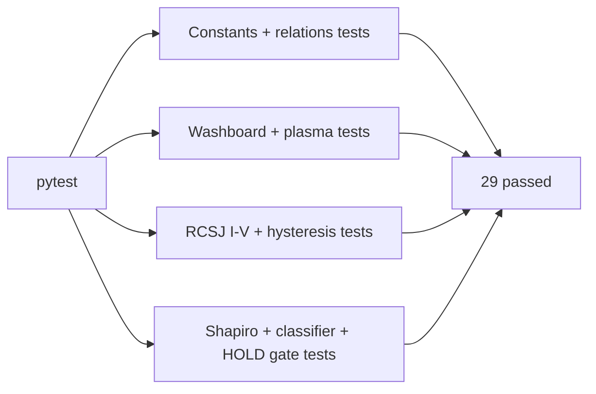
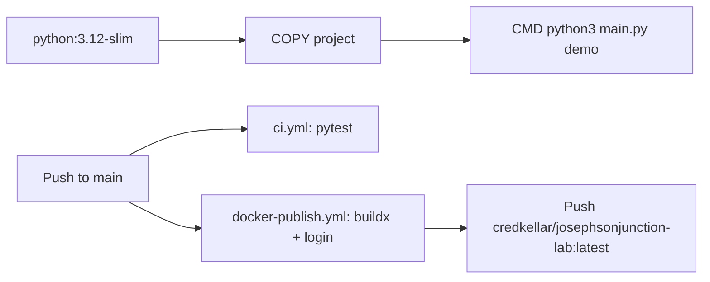

# JosephsonJunction-Lab ⚡🧲

**Josephson Junction Dynamics Lab** — by Darion Kellar

JosephsonJunction-Lab is an **educational Josephson junction dynamics lab** in ONE pure-Python file. It takes ONE **labelled teaching junction** — critical current **Ic = 1 µA**, capacitance **C = 1 pF**, chosen so the arithmetic is easy to follow — and computes its textbook physics **from scratch**: the two Josephson relations, the tilted **washboard potential**, the **plasma frequency**, **RCSJ current–voltage dynamics** in the overdamped and underdamped regimes, **hysteresis**, and the **AC Josephson effect (Shapiro steps)** under RF drive. 🔬

The lab's discipline is that **every headline number is graded against a closed form**: washboard barrier heights against the exact formula `2E_J[√(1−i²) − i·arccos(i)]`, the plasma frequency against a numerically integrated phase particle, the overdamped I–V curve against the analytic `R·√(I² − Ic²)` limit, the retrapping current against `4/(π√βc)`, and the Shapiro plateau voltages against `V_n = n·h·f/(2e)`. Where simulation and closed form honestly differ — the finite-capacitor excess on the I–V curve — the difference is **printed, not hidden**. 📏

Honest scope, stated up front: the labelled Ic and C are **teaching numbers, not a device specification** — no junction was fabricated, cooled, biased, or measured, and a simulated Shapiro step **calibrates nothing**. Every real-device, fabrication, cryogenic, metrology, and deployment use sits behind a permanent HOLD gate (14 total). 🔒

[](https://github.com/kimanicollier44-cmyk/JosephsonJunction-Lab/actions/workflows/ci.yml)
[](https://github.com/kimanicollier44-cmyk/JosephsonJunction-Lab/actions/workflows/docker-publish.yml)

> ℹ️ These are the **live** workflow badges for this repo. They activate as soon as the `ci.yml` and `docker-publish.yml` files from the paste pack are pasted into `.github/workflows/` — until then they have nothing to report yet.

## 🧰 Tech Stack Badges & Full Architecture Tech Stack

### 💻 Core Programming Languages & Core Systems


- 🐍 Python 3.12, pure standard library (`math`, `hashlib`, `json`, `sys`) — zero dependencies, zero network, deterministic (double-run byte-identical)
- ⚡ Josephson core from scratch: the two relations `I = Ic·sin φ` and `V = (ħ/2e)·dφ/dt`, the washboard potential `U(φ) = −E_J·cos φ − (ħI/2e)·φ` with extrema located by grid scan + bisection on `sin φ − i`, and the exact barrier law `ΔU = 2E_J[√(1−i²) − i·arccos(i)]` — every barrier asserted against the closed form in CHECKS
- 🌀 Dynamics core: the RCSJ equation `(Cħ/2e)φ¨ + (ħ/2eR)φ˙ + Ic·sin φ = I` in dimensionless form, integrated with fixed-step RK4 written out stage by stage — plasma oscillations measured from zero crossings, I–V curves time-averaged, hysteresis swept with carried state, Shapiro steps scanned under RF drive
- 🎛️ Exact SI constants: ħ, e, h as defined; `Φ0 = h/2e = 2.067834e-15 Wb` and `K_J = 483.597848 MHz/µV` fall out of them, never typed in as results
- 🧠 TinyML kNN regime classifier (from scratch, stdlib, distance-weighted): superconducting-static / oscillating / resistive-running / shapiro-locked from (I/Ic, βc, measured ⟨V⟩), labels from the lab's own regime policy
- 🪑 Council seats: Gemini Argon 4 DECIDER (names-only, tighten-only) + Muse advisor (never overrides HOLD) + Google Flow plan-only (rendered = False, live = 0)

### ⛓️ Web3 & Infrastructure

- 🚫 **Not applicable — honestly.** No blockchain, no Web3, no tokens: the "infrastructure" in this lab is one offline file holding a phase particle, a washboard, and an RK4 integrator. No fake badges here.

### ⚙️ Platform Support & Hardware Architecture


- 🖥️ Pure Python — runs anywhere Python 3.12+ runs (Linux, macOS, Windows), plus the `python:3.12-slim` Docker image
- 🔒 No hardware is controlled, ever: real junctions, SQUIDs, cryostats, and qubit devices are permanent HOLD gates (see the gate table below)

### ⚡ Low-Level Infrastructure & Performance

- 🚫 **No low-level code — honestly.** No C, no C++, no GPU, no compiled extensions: this is one interpreted Python file on purpose, so every RK4 stage can be read, checked, and diffed. Performance here means honest algorithms — bisection-refined washboard extrema, zero-crossing period measurement, and long fixed-step averaging runs — all deterministic and byte-identical between runs.

### 🛠️ DevOps & Build Tools


- 🐳 Docker (`python:3.12-slim`), GitHub Actions CI + Docker Publish (delivered in the paste pack)
- 🎯 Target image: `credkellar/josephsonjunction-lab:latest`
- 🧪 Tests: `pytest` (29 tests) + the built-in CHECKS suite (54 checks) in `main.py`

### ☁️ Cloud Providers

- 🚫 **None — honestly.** No cloud provider is used or needed: the lab runs fully offline on your own machine or in a local Docker container. Docker Hub appears only as the registry the publish workflow pushes the image to.

## What this does?

1. ⚡ **The two Josephson relations, as the core** — `I = Ic·sin φ` (current through a junction with zero voltage) and `V = (ħ/2e)·dφ/dt` (a running phase *is* a voltage). The lab prices them for the labelled junction: a phase winding at 1 GHz is exactly **2.067834 µV**, and a DC voltage of 10 µV makes the junction oscillate at **4.835978 GHz** — the Josephson constant `K_J = 483.597848 MHz/µV` computed from exact SI constants, not quoted.
2. 🌋 **Derived energy scales** — `E_J = ħIc/(2e) = 3.291060e-22 J`, printed as **496.684 GHz·h**; the charging energy `E_C/h = 19.370 MHz`, so `E_J/E_C = 25,642` — this junction lives deep in the classical-phase regime, which is exactly why the phase-particle picture below is the right model. Josephson inductance `L_J = 0.3291 nH`.
3. 🏔️ **Washboard potential + barrier law** — `U(φ) = −E_J·cos φ − (ħI/2e)·φ` tilts with bias. Minima and maxima are located numerically (scan + bisection on `sin φ − i`) and the barrier is graded against the closed form `2E_J[√(1−i²) − i·arccos(i)]`: **2.00000000** at i = 0, **0.68485326** at i = 0.5, **0.05993153** at i = 0.9, **0.00188656** at i = 0.99 — agreement to machine precision — and the well is **gone** at i = 1.0 and 1.1.
4. 🔔 **Plasma frequency, integrated not quoted** — small oscillations in a well should run at `ω_p = ω_p0·(1−i²)^{1/4}` with `ω_p0 = √(2eIc/ħC)`, `f_p0 = 8.773083 GHz`. The lab integrates the undamped phase particle with RK4 and *measures* the period from zero crossings: relative error **1.6e-04** at i = 0, **2.4e-04** at i = 0.5, **1.2e-03** at i = 0.9 — the tiny deficit is the finite-amplitude anharmonic correction, printed as measured.
5. 📈 **RCSJ I–V curves, both damping regimes** — the full RCSJ equation integrated with RK4 for the overdamped junction (βc = 0.25, R = 9.0706 Ω) and the underdamped junction (βc = 16, R = 72.5651 Ω). Below Ic both sit at **exactly V = 0**; above Ic the underdamped curve runs near `⟨V⟩ ≈ I·R` (1.999751 of IcR at i = 2) while the overdamped curve follows the square-root law.
6. 🎯 **The analytic limit, graded honestly** — in the βc → 0 (pure RSJ) limit the same integrator reproduces `V = R·√(I² − Ic²)` to **0.28% or better** at i = 1.1 / 1.5 / 2.0. The real capacitor at βc = 0.25 sits measurably **above** that curve — **+3.03%** at i = 1.5, **+2.68%** at i = 2.0 — a genuine finite-βc effect that the lab reports as a headline number instead of tuning it away.
7. 🔁 **Hysteresis, swept like a real measurement** — on the underdamped junction the bias is swept up and back down in 0.05 steps with the phase state carried point to point: it **switches at i = 1.00** on the way up and **retraps at i = 0.30** on the way down (last running point 0.35), bracketing the large-βc estimate `4/(π√βc) = 0.318310`. Loop width **0.70·Ic** — between those currents, the voltage depends on history.
8. 📶 **Shapiro steps — the AC Josephson effect** — with an RF drive at `f = 4.386542 GHz` (ω = 0.5·ω_p0, I_rf = 0.75·Ic) on the overdamped junction, the time-averaged voltage locks onto plateaus at `V_n = n·h·f/(2e)`: measured **0.0222 µV** (n = 0, i ∈ [0, 0.85]), **9.0972 µV** vs exact 9.0706 (n = 1, i ∈ [1.10, 1.55]), **18.1626 µV** vs exact 18.1413 (n = 2, i ∈ [2.15, 2.25]) — each within 0.3% of `n·Φ0·f`, widths shrinking with n.
9. 🏷️ **Regime classifier** — a from-scratch distance-weighted kNN labels operating points superconducting-static / oscillating / resistive-running / shapiro-locked from (I/Ic, βc, measured ⟨V⟩), with features taken from the lab's own simulation runs (the RF scenarios land on the n = 1 and n = 2 steps and are labelled shapiro-locked); kNN is asserted equal to the lab's regime policy on all scenarios and the full 484-point training grid in CHECKS.
10. 🔒 **Seats, gates, checks** — Gemini Argon 4 DECIDER (sha256 trace, tighten-only), Muse advisor, Google Flow plan-only, 14 permanent HOLD gates (`hold-demo` exits 2), and a built-in CHECKS suite (54 checks) that re-grades every claim above on every run.

## 🗺️ How it works — diagram per script

### `main.py` — relations + washboard subsystem

```mermaid
flowchart TD
    A[CLI: demo / checks / relations] --> B[Two Josephson Relations: I = Ic sin phi, V = hbar/2e dphi/dt]
    B --> C[Derived Scales: E_J, E_C, L_J, Phi0, K_J]
    C --> D[Washboard Potential U = -E_J cos phi - bias tilt]
    D --> E[Extrema: grid scan + bisection on sin phi - i]
    E --> F[Barrier graded vs 2E_J sqrt(1-i^2) - i arccos(i)]
    F --> G[Plasma: RK4 phase particle, period from zero crossings]
    G --> H[Graded vs omega_p0 times (1-i^2)^1/4]
```

### `main.py` — RCSJ dynamics + Shapiro subsystem

```mermaid
flowchart TD
    A[RCSJ Equation: phi'' + phi'/sqrt(beta_c) + sin phi = i] --> B[RK4 fixed-step integrator]
    B --> C[I-V Curves: beta_c 0.25 and 16]
    C --> D[RSJ Limit graded vs R sqrt(I^2 - Ic^2)]
    B --> E[Hysteresis Sweep: state carried up and down]
    E --> F[i_switch = 1.00 vs i_retrap = 0.30]
    B --> G[RF Drive: Shapiro Scan]
    G --> H[Plateaus graded vs V_n = n Phi0 f]
    C --> I[kNN Regime Classifier]
    F --> I
    H --> I
```

### `tests/test_main.py` — verification



### `Dockerfile` + CI flow — container & publish



## Why is this cool?

1. ⚡ The whole of Josephson physics really is two lines — and this lab shows both of them *earning* every later result: the washboard, the plasma ringing, the hysteresis, and the voltage steps all fall out of `I = Ic·sin φ` and `V = (ħ/2e)·φ˙`.
2. 🏔️ The washboard barrier is **located numerically and graded against its closed form to machine precision** — 2.00000000 → 0.00188656 → gone, the entire supercurrent story in one shrinking number.
3. 🔔 The plasma frequency is **measured, not quoted**: an RK4 phase particle rings in the well, its period is read off zero crossings, and the (1−i²)^¼ softening law is confirmed to ~1e-03 — anharmonicity included and admitted.
4. 🎯 The I–V section refuses the easy fudge: the βc → 0 limit is graded against `R·√(I²−Ic²)`, and the real capacitor's **+3% excess** at βc = 0.25 is reported as a result, not tuned away.
5. 🔁 Hysteresis is produced the honest way — state carried up and down a 0.05-step sweep — so switching at exactly Ic and retrapping at 0.30 bracket the textbook `4/(π√βc)` from the simulation itself.
6. 📶 Shapiro steps land within **0.3%** of `n·Φ0·f` at n = 0, 1, 2 with shrinking widths — the effect that defines the real-world volt, reproduced by one RK4 loop and graded against `h·f/2e`.
7. 🧮 The constants are *derived*: `K_J = 483.597848 MHz/µV` and `Φ0` come out of the exact SI ħ, e, h — the lab never types in the answer it claims to compute.
8. 🏷️ The classifier's features are **measured by the lab's own dynamics** — the shapiro-locked scenarios are voltages read off the RF scan, not hand-placed points.
9. 🔒 `E_J/E_C = 25,642` is printed up front: the lab states *why* its classical phase-particle model is the right one for this junction instead of assuming it.
10. 🎯 Deterministic end to end: run it twice, get byte-identical output — a Josephson junction you can diff.

## What problems this solves?

1. ❌ **Problem:** Josephson effects are usually taught as a museum of unrelated formulas. ✅ **Solution:** One file derives the washboard, plasma frequency, I–V curves, hysteresis, and Shapiro steps from the same two relations, so the connections are visible in the code.
2. ❌ **Problem:** "The barrier vanishes at Ic" is asserted, never shown. ✅ **Solution:** Extrema are located numerically at six biases and graded against the exact barrier law; the well is demonstrably gone at i = 1.0 and 1.1.
3. ❌ **Problem:** Plasma frequency is quoted as `√(2eIc/ħC)` with the bias dependence forgotten. ✅ **Solution:** The (1−i²)^¼ softening is verified by integrating the phase particle and measuring its period at three biases.
4. ❌ **Problem:** Textbook I–V curves hide which model produced them. ✅ **Solution:** The lab separates the three honestly — full RCSJ at βc = 0.25, full RCSJ at βc = 16, and the βc → 0 RSJ limit — and grades only the limit against the analytic curve, reporting the finite-βc excess in the open.
5. ❌ **Problem:** Hysteresis is drawn as a cartoon loop with invented currents. ✅ **Solution:** The loop comes from a state-carrying sweep: switching at 1.00, retrapping at 0.30, the analytic estimate bracketed by the simulated points.
6. ❌ **Problem:** Shapiro steps are presented as metrology magic. ✅ **Solution:** The RF scan shows the plateaus forming, their widths shrinking with n, and their voltages matching `n·h·f/(2e)` — while the `voltage_metrology_claim` gate states plainly that a simulated step calibrates nothing.
7. ❌ **Problem:** Labelled teaching parameters get silently upgraded into device specs. ✅ **Solution:** Ic = 1 µA and C = 1 pF are labelled at every appearance, and `hardware_specification_claim` is a permanent HOLD gate.
8. ❌ **Problem:** Simulation tools blur into control tools. ✅ **Solution:** Real-device control, fabrication, cryogenic operation, and SQUID deployment are four separate permanent HOLD gates, and `hold-demo` exits 2.
9. ❌ **Problem:** Numerical integrators in teaching code are trusted without evidence. ✅ **Solution:** The same RK4 is graded four independent ways — barrier law, plasma law, RSJ limit, Shapiro relation — plus a 29-test pytest suite and 54 built-in checks.
10. ❌ **Problem:** "Quantum" branding gets pasted onto classical models. ✅ **Solution:** The lab computes `E_J/E_C` and states its regime: this junction's phase is a classical particle, and the quantum-regime story is a different lab.

## How to install this?

1. 📋 Clone or download this project folder.
2. 🐍 Make sure Python 3.12+ is installed: `python3 --version`
3. ▶️ Run the full demo + checks (no arguments needed):

```bash
python3 main.py
```

4. 🧪 Run the test suite:

```bash
pip install pytest
python3 -m pytest -q
```

5. 🎛️ Try the other commands:

```bash
python3 main.py checks      # 54 built-in checks
python3 main.py relations   # the two relations + derived scales (JSON)
python3 main.py washboard   # washboard extrema + barrier table (JSON)
python3 main.py plasma      # plasma frequency: measured vs theory (JSON)
python3 main.py iv          # RCSJ I-V curves + hysteresis sweep (JSON)
python3 main.py shapiro     # Shapiro step scan + plateaus (JSON)
python3 main.py classify    # kNN regime classifier report
python3 main.py brains      # Argon 4 + Muse + Flow seats
python3 main.py holds       # list all 14 HOLD gates
python3 main.py hold-demo   # exits 2 - gated actions stay HOLD
```

6. 🐳 Or run it in Docker:

```bash
docker build -t credkellar/josephsonjunction-lab:latest .
docker run --rm credkellar/josephsonjunction-lab:latest
```

## Requirements

- 🐍 Python 3.12 or newer
- 📦 Dependencies: **none** (standard library only)
- 🌐 Network: **none** — fully offline
- 🧪 For tests only: `pytest`
- 🐳 Optional: Docker

## FULL project structure tree

```text
josephsonjunction-lab/
├── main.py                  # the whole lab: relations, washboard, plasma, RCSJ I-V, hysteresis, Shapiro steps, classifier, seats, HOLD gates
├── conftest.py              # puts the project root on sys.path for tests
├── tests/
│   └── test_main.py         # 29 pytest tests: constants, relations, washboard, plasma, I-V, hysteresis, Shapiro, classifier, gates, CLI
├── assets/
│   └── cover.png            # README cover image (2736 x 912)
├── Dockerfile               # python:3.12-slim, runs the demo
├── .gitignore               # __pycache__/, .pytest_cache/, *.pyc
└── README.md                # this file
```

> 📦 Delivered separately as paste packs (not in this tree): `.github/workflows/ci.yml` + `docker-publish.yml`, and the Docker Hub pack (100-char description, 350-char About, overview, categories).

## 🔒 HOLD gates — all 14, permanent

| # | Gate | What stays held |
|---|------|-----------------|
| 1 | `real_device_control` | No control of a real Josephson junction, SQUID, or qubit device |
| 2 | `junction_fabrication` | No fabrication guidance for real junctions, barriers, or wafers |
| 3 | `cryogenic_operation` | No operation of cryostats, dilution refrigerators, or cryogenic plant |
| 4 | `squid_magnetometer_deployment` | No deploying SQUIDs or Josephson magnetometers in the field |
| 5 | `voltage_metrology_claim` | No voltage-standard or calibration claim; a simulated Shapiro step calibrates nothing |
| 6 | `qubit_hardware_claim` | No claims about real superconducting-qubit hardware, coherence, or fidelity |
| 7 | `hardware_specification_claim` | The labelled Ic and C are teaching numbers, never a device specification |
| 8 | `vendor_benchmark_claim` | No vendor benchmark, product comparison, or performance claim |
| 9 | `medical_magnetometry_use` | No medical magnetometry (MEG, cardiac, diagnostic) use of this model |
| 10 | `geophysics_survey_use` | No geophysical, mineral, or archaeological survey deployment |
| 11 | `nondestructive_testing_use` | No nondestructive-testing or inspection use of this model |
| 12 | `remove_human_override` | The human override is never removed from any coupled system |
| 13 | `exceed_rated_bias_live` | Never exceed a rated bias, field, or temperature on live hardware |
| 14 | `simulation_as_measurement_claim` | A simulated voltage, frequency, or step is not a measurement |

🧑‍⚖️ **Council seats:** Gemini Argon 4 Extended Thinking — DECIDER (names-only, tighten-only, MAP → MODEL → STRESS → DECIDE, sha256 trace, `can_override_hold = False`) · Muse — advisor (`can_override_hold = False`) · Google Flow — plan-only (`rendered = False`, `live = 0`).

✅ **Verification:** pytest **29 passed** (project + clean copy) · built-in CHECKS **54/54** · double-run output **byte-identical** · `hold-demo` exits **2** · `main.py` **966 lines**, pure stdlib, zero network.

## 🧒 5th-grade English section

Imagine a sandwich made of two superconductors with a super-thin filling. Even with **no battery at all**, an electric current can flow through the filling — as if by magic. That is the Josephson effect, and this lab does its math. 🥪

- The junction has a favourite number called its **phase**. One rule says how much current flows for each phase, and another rule says: if the phase spins around, that spinning *is* a voltage. Two rules — everything else in the lab is just those two rules working hard. ⚡
- Picture the phase as a marble rolling on a **washboard** — a bumpy metal sheet. Tilt the sheet a little (that is the current you push in) and the marble sits in one dip and nothing happens: no voltage. Tilt it more and the dips get shallower. Tilt it past the special current **Ic** and the dips disappear — the marble rolls and rolls, and rolling means voltage! 🎢
- A marble sitting in a dip can wiggle back and forth. How fast it wiggles is called the **plasma frequency** — about 8.77 billion wiggles per second for this pretend junction. The lab sets the marble wiggling inside the computer and *counts* the wiggles to check the formula. 🔔
- Some junctions are like a marble in honey (overdamped — it stops quickly) and some are like a marble on ice (underdamped — it keeps going). The icy one is forgetful in a funny way: coming back down, it keeps rolling even at currents where it would never have started. That loop is called **hysteresis**. 🧊
- Shine a radio wave at the junction and something amazing happens: the voltage stops being smooth and climbs in **exact steps**, like stairs. The step height is set by one of nature's most exact numbers, so real scientists use these steps to define the volt! This lab climbs the first three steps and measures them. 🪜
- This project is a **pretend lab on a computer**. It does not build a real junction, cool anything down, or measure a real volt. It helps you learn how two short rules turn into washboards, wiggles, loops, and stairs. 💻

---

MIT © 2026 Darion Kellar · JosephsonJunction-Lab — educational simulation only ⚡
